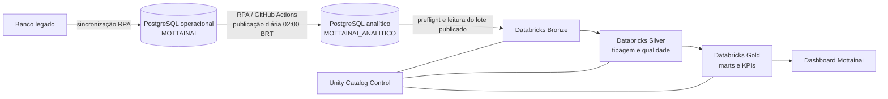

# Business Intelligence — Mottainai

> Guia de arquitetura, métricas e operação do ambiente analítico.
> Revisão documental: 31/10/2026. Os detalhes operacionais abaixo foram
> conferidos contra os documentos e arquivos locais dos repositórios de BI,
> banco e RPA disponíveis nesta data. Confirme o estado do deploy antes de
> tratar uma configuração versionada como configuração ativa.

## Objetivo e público

Esta documentação explica como os dados da Mottainai chegam ao dashboard, como
são transformados nas camadas Bronze, Silver e Gold, o que cada KPI significa,
quais limitações precisam aparecer para quem toma decisões e como operar a carga
diária. É destinada a engenharia de dados, desenvolvimento, operações, produto,
gestão e à equipe acadêmica.

O banco analítico e o Databricks são ambientes de leitura e análise. O sistema
transacional continua escrevendo no banco operacional. Um indicador mostrado no
dashboard representa a publicação analítica identificada pelo seu lote e corte;
não representa estado em tempo real.

## Navegação

| Documento | Conteúdo |
|---|---|
| [Arquitetura e linhagem](01-arquitetura-e-linhagem.md) | Bancos físicos, Unity Catalog, integrações, cadência e contrato de lote |
| [Camadas medalhão](02-camadas-medalhao.md) | Responsabilidade de Bronze, Silver, Gold e Control; objetos e critérios de promoção |
| [Catálogo de KPIs](03-catalogo-de-kpis.md) | Definições, fórmulas, grãos, filtros, estado e dependências dos indicadores |
| [Dashboard e experiência de uso](04-dashboard.md) | Páginas, datasets, filtros, interpretação e checklist de usabilidade |
| [Qualidade e governança](05-qualidade-e-governanca.md) | Regras de dados, privacidade, acesso, mudanças e critérios de aceite |
| [Runbook operacional](06-runbook.md) | Acompanhamento diário, consultas de verificação, reexecução e falhas |

## Arquitetura em uma página

O encadeamento de ponta a ponta tem três responsabilidades diferentes:

1. **Legado → operacional:** integração de sistemas, independente do BI. O
   snapshot do workflow local analisado usa intervalo de 30 minutos; a meta de
   cinco minutos solicitada pela equipe precisa ser confirmada no workflow
   mesclado e ativo antes de ser documentada como configuração vigente.
2. **Operacional → analítico:** lote diário do RPA às 02:00 no fuso
   `America/Sao_Paulo`. A carga usa os bancos PostgreSQL físicos `MOTTAINAI` e
   `MOTTAINAI_ANALITICO`, em conexões de leitura e escrita separadas.
3. **Analítico → medalhão → dashboard:** job Databricks previsto para 02:30,
   após a publicação do RPA. O job tem cinco tarefas sequenciais: preflight,
   Bronze, Silver, Gold e atualização do dashboard.

O fluxo não é uma réplica em tempo real e não deve ligar gráficos diretamente
ao banco operacional. O painel usa apenas objetos Gold publicados.

## Nomes que não devem ser confundidos

| Nome | Tipo | Uso |
|---|---|---|
| `MOTTAINAI` | Database PostgreSQL | Banco físico operacional |
| `MOTTAINAI_ANALITICO` | Database PostgreSQL | Banco físico que recebe os lotes analíticos |
| `mottainai_analytics` | Schema PostgreSQL | Contratos de lote, fatos, dimensões, views e logs do banco analítico |
| `motta_analytics` | Catálogo Unity Catalog | Destino governado Delta dentro do Databricks |
| `motta_analytics.bronze` | Schema Unity Catalog | Dados trazidos do lote publicado |
| `motta_analytics.silver` | Schema Unity Catalog | Dados tipados e validados |
| `motta_analytics.gold` | Schema Unity Catalog | Data marts e indicadores para consumo |
| `motta_analytics.control` | Schema Unity Catalog | Marcadores de publicação e controle do pipeline |

O nome de um catálogo do Databricks não é o nome do database PostgreSQL. Para
ver tabelas Gold em Databricks SQL, use o nome de três partes, por exemplo
`motta_analytics.gold.sales_daily`. No PostgreSQL, conecte-se ao database
`MOTTAINAI_ANALITICO` e consulte `mottainai_analytics.<objeto>`; PostgreSQL não
permite referenciar outro database por `database.schema.table`.

## Estado dos dados e leitura responsável

Uma carga tecnicamente bem-sucedida não prova que a origem tinha eventos. O
dashboard deve diferenciar:

- **zero:** a consulta executou e não encontrou eventos na população definida;
- **sem valor (`NULL`):** não há denominador, observação ou evidência suficiente
  para calcular o indicador;
- **falha:** conexão, contrato, execução ou regra de qualidade não passou;
- **dado defasado:** o lote existe, mas o corte não é recente o bastante para a
  decisão em questão.

Em 30/10/2026, a documentação do projeto registrava apenas um dia com vendas,
uma loja vendedora e ausência de eventos em parte dos fatos operacionais novos.
Esse é um retrato histórico da validação, não uma afirmação automática sobre o
estado atual. Consulte sempre `batch_id`, `source_cutoff_at`, `published_at` e
os resultados Silver antes de interpretar tendência, dispersão ou impacto.

## Repositórios de referência

- [Mottainai-Hub](https://github.com/Mottainai-One/Mottainai-Hub): arquitetura e
  documentação central.
- [Mottainai-BI](https://github.com/Mottainai-One/Mottainai-BI): notebooks,
  bundle Databricks, datasets SQL, dashboard e documentação específica de BI.
- [Mottanai-RPA](https://github.com/Mottainai-One/Mottanai-RPA): sincronizações
  e publicação de lotes.
- [Mottainai-Banco-Operacional](https://github.com/Mottainai-One/Mottainai-Banco-Operacional):
  contratos e scripts PostgreSQL operacional/analítico.

Esta documentação no Hub explica o produto de dados. O código executável,
migrations, schedules e IDs ativos devem ser alterados no repositório que os
possui e refletidos aqui após revisão.

## Referências de UX do primeiro ano

Os documentos `UX_AnaliseHeuristuca_CRUD.docx` e
`UX_AnaliseHeuristica_Landing.docx` foram compartilhados como referências de
avaliação heurística da aplicação e do site. Eles ajudam a estabelecer uma
linguagem comum de visibilidade, consistência, prevenção de erros, reconhecimento
e clareza. Eles **não são uma avaliação do dashboard** nem evidência de testes
com usuários do BI. Os critérios específicos do dashboard estão em
[Dashboard e experiência de uso](04-dashboard.md) e precisam ser verificados
no próprio painel.
