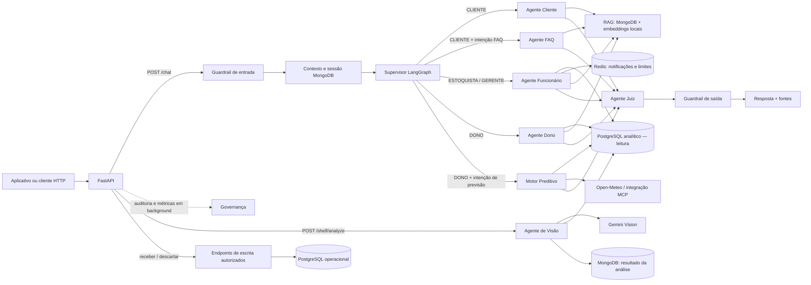

# Mottainai Inteligência Artificial

**Documentação funcional e técnica**

**Projeto interdisciplinar Mottainai**

**Atualização:** 31/10/2026

O Mottainai Inteligência Artificial apoia o combate ao desperdício de alimentos por meio de atendimento conversacional, consulta a informações, previsão de demanda e análise de prateleiras. Esta documentação apresenta sua arquitetura, agentes, fluxos, integrações e condições de operação.

As capacidades dependem das configurações, dos serviços e dos dados disponíveis em cada ambiente. As limitações e definições ainda necessárias estão registradas nas respectivas seções; a documentação não substitui a homologação integrada da solução.

## 1. Resumo executivo

O **Mottainai IA Layer** é um serviço Python com API FastAPI e orquestração multiagente usando LangGraph. Ele recebe mensagens, identifica o perfil autenticado, seleciona um agente de domínio e valida a resposta antes de devolvê-la. A camada também oferece análise de fotos de prateleira, consultas analíticas, operações operacionais específicas e integrações MCP/A2A.

A IA **não é um único modelo que faz tudo**. O sistema combina:

- modelos de linguagem para conversar e explicar dados;
- consultas determinísticas a PostgreSQL, MongoDB e Redis;
- recuperação semântica de documentos internos (RAG);
- cálculo de previsão implementado em Python;
- visão computacional do Gemini para imagens de prateleira;
- validação de resposta pelo Agente Juiz e guardrails determinísticos.

O modelo não deve inventar números nem executar uma ação de negócio apenas porque recomendou essa ação. O descarte e o recebimento de mercadoria passam por endpoints próprios, com autorização, idempotência e gravação auditável no banco operacional.

## 2. Escopo da camada

A camada de IA é um **serviço de inteligência e integração** que complementa as APIs dos aplicativos. Ele expõe chat, previsão, visão computacional, administração de documentos RAG, métricas e algumas operações operacionais. A API de IA não substitui a API de produtos, cadastro, promoções, lojas, fidelidade ou o restante do backend Mottainai.

| Capacidade | Como é feita |
| --- | --- |
| Respostas conversacionais | LLM + contexto do perfil, histórico e ferramentas de domínio |
| Busca de conhecimento | Embeddings locais e similaridade de cosseno sobre chunks no MongoDB |
| Previsão de demanda | Cálculo determinístico em Python; o LLM explica o resultado |
| Risco e sugestões | Regras/contexto de negócio + narrativa do LLM; o resultado do motor não é persistido como sugestão de negócio |
| Leitura de prateleira | Gemini Vision, cruzamento com inventário e relatório textual |
| Escritas de negócio implementadas | Recebimento de mercadoria e descarte de lote existente |
| Governança | Telemetria e auditoria assíncrona; não é o mecanismo primário de autorização |

## 3. Arquitetura geral

O diagrama resume caminhos diferentes. A análise de imagem não percorre o Supervisor de chat. O endpoint manual do Motor também pode chamá-lo diretamente. A Governança é disparada como tarefa de background depois de uma resposta de chat, sem bloquear a resposta.

## 4. Fluxo de uma conversa

1. O cliente envia `POST /chat` com a mensagem e um `session_id`, junto de um `Authorization: Bearer ...` válido.
2. A API valida o token e extrai `usuario_id`, `empresa_id` e `role` da autenticação. Esses valores não vêm do JSON enviado pelo cliente.
3. O guardrail de entrada valida tamanho e conteúdo, remove padrões comuns de dados pessoais e aplica limite de requisições por usuário/empresa.
4. A camada de memória encontra ou cria uma conversa no MongoDB e carrega histórico recente e memória de longo prazo, sempre associando a sessão ao usuário e à empresa autenticados.
5. O Supervisor escolhe o agente permitido para aquele perfil. A seleção de intenção de FAQ/Previsão usa catálogo de intenções no MongoDB e palavras-chave de fallback; Estoquista e Gerente seguem diretamente para o agente Funcionário.
6. O agente reúne as fontes permitidas para seu domínio, monta o contexto e pede uma resposta ao modelo configurado.
7. O Agente Juiz avalia grounding, escopo e confiança. Só aprova se `grounding_ok` e `scope_ok` forem verdadeiros e o score for pelo menos `0,7`. Uma rejeição recebe uma reavaliação independente; falha técnica ou nova rejeição gera uma resposta segura predefinida.
8. O guardrail de saída remove padrões residuais de PII e bloqueia certos termos sensíveis. A resposta e as fontes são registradas no histórico MongoDB.
9. A API devolve resposta, agente escolhido, fontes, score do Juiz e latência. Métricas, execução de ferramentas, roteamento e Governança são registrados em background.

O `session_id` pertence a um único usuário e empresa. A sessão expira por inatividade (60 minutos por configuração), mas seu encerramento não apaga as mensagens: elas permanecem para histórico/auditoria. Os endpoints de histórico limitam quantas mensagens retornam por chamada.

## 5. Agentes e responsabilidades

| Agente | Perfil/entrada | Responsabilidade e fontes |
| --- | --- | --- |
| **Supervisor** | Todas as mensagens de chat | Aplica o roteamento permitido por perfil e registra a decisão. Não consulta RAG nem executa ferramentas de negócio. |
| **Cliente** | `CLIENTE` | Promoções, lojas, fidelidade, sustentabilidade e uso do app. Usa RAG e histórico; não consulta PostgreSQL diretamente. |
| **FAQ** | Intenções gerais de `CLIENTE` | Responde dúvidas gerais sobre o Mottainai usando o mesmo mecanismo RAG do Agente Cliente. |
| **Funcionário** | `ESTOQUISTA` e `GERENTE` | Estoque, alertas, inventário, procedimentos, notificações e análises recentes de prateleira. Consulta dados analíticos e RAG. O chat não executa recebimento nem descarte. |
| **Dono** | `DONO` | KPIs, vendas, perdas, alertas, comparação entre lojas e recomendações estratégicas, com dados analíticos e RAG. |
| **Motor Preditivo** | Pergunta de previsão do Dono ou `POST /motor-preditivo/trigger` | Calcula previsão de demanda e prepara riscos, ações e reposição para a resposta. Não grava alertas ou sugestões nas tabelas de negócio. |
| **Visão** | `POST /shelf/analyze` | Envia a imagem ao Gemini, estima produtos/ocupação/slots vazios e cruza nomes detectados com dados de inventário. Não é um nó do grafo de chat. |
| **Juiz** | Depois do agente de domínio | Avalia escopo, grounding e confiança; falha fechada. O campo `revised_response` do modelo avaliador não é usado para reescrever a resposta. |
| **Governança** | Background e `/audit/report` | Agrega execuções, erros, latências, avaliações e dados de conformidade. A tarefa assíncrona não bloqueia a resposta. |

### Chamadas nativas de ferramentas

Funcionário e Dono têm dois caminhos selecionados pela configuração `NATIVE_TOOL_CALLING_ENABLED`:

- **Padrão desativado:** cada agente consulta previamente seus conjuntos de fontes e envia os dados reunidos ao LLM.
- **Ativado:** o LLM decide quais ferramentas de leitura chamar, com até três rodadas por resposta por padrão.

No agente Funcionário, notificações e resumo de visão recente continuam sendo carregados em ambos os caminhos. As ferramentas expostas nesse modo são de leitura; as escritas continuam fora do chat.

## 6. Dados, memória e RAG

### PostgreSQL: duas fronteiras

O serviço usa conexões separadas para o banco operacional e para o banco analítico.

- **Operacional:** fonte oficial de identidade/permissões e destino das duas operações de escrita implementadas. A IA não cria nem migra o schema; ele é mantido pela camada de banco operacional do Mottainai. O banco valida vínculo e autorização e aplica RLS.
- **Analítico:** consultas de negócio para IA/mobile são somente leitura. As consultas de negócio não recorrem automaticamente ao banco operacional quando a fonte analítica está indisponível. O resultado inclui a data da última publicação analítica; sem uma publicação disponível, consultas retornam indisponibilidade (503).
- O snapshot analítico não contém todos os campos do banco operacional. O README destaca que quantidade máxima, código textual do lote e alguns campos descritivos/prioridade de alerta podem não estar disponíveis; a IA deve assumir essa ausência, não preencher por inferência.

As tabelas/fatos citados pelo README para o banco analítico incluem `dim_company`, `dim_store`, `dim_product`, `fact_sales`, `fact_sale_item`, `fact_loss_destination`, `fact_alert_snapshot`, `fact_inventory_snapshot` e `vw_published_batch`.

### MongoDB

Armazena conversas, mensagens, memória de longo prazo, documentos e chunks RAG, resultados de visão, avaliações do Juiz, execução de ferramentas e telemetria/auditoria. Consultas de histórico são limitadas por `empresa_id` e `usuario_id`. O histórico inclui as fontes RAG registradas na resposta.

### Redis

É usado para rate limit, cache RAG, notificações/inbox, revogação de token e idempotência de escrita. O cache RAG é uma otimização: se ele falhar, a busca continua sem cache. Algumas proteções de tráfego são fail-closed: se o Redis não puder aplicar o limite de uma operação protegida, a API devolve 503.

### Recuperação RAG

1. O texto é separado por parágrafos; parágrafos longos são divididos por sentenças em trechos de até 800 caracteres.
2. O modelo local `all-MiniLM-L6-v2` gera embeddings normalizados.
3. A busca carrega os chunks da empresa no MongoDB e calcula similaridade de cosseno em lote em Python (busca exaustiva, não Atlas Vector Search nem pgvector).
4. São considerados resultados com score mínimo `0,4`; o padrão retorna até cinco chunks.
5. O contexto e suas referências são guardados em cache Redis por empresa/pergunta. Textos exatamente duplicados são incluídos uma única vez no prompt.

Gerente e Dono podem adicionar/remover documentos por API. O endpoint recebe texto, cria chunks e embeddings imediatamente. `source` pode ser mapeado para categorias `MANUAL`, `FAQ`, `PROCEDIMENTO`, `TREINAMENTO` ou `POLITICA`.

**Ponto de segurança:** a busca atual filtra por `empresaId`, mas não filtra por categoria nem por perfil. Portanto, os mesmos documentos/chunks podem ser recuperados tanto por agentes públicos de Cliente/FAQ quanto por agentes internos. Os prompts pedem que o agente Cliente não revele dados internos, mas essa instrução não substitui isolamento de dados na recuperação. Separe documentos públicos e internos no filtro RAG antes de considerar esse canal seguro para conteúdo operacional confidencial.

## 7. Motor Preditivo

O Motor reúne:

- resumo de vendas dos últimos 60 dias;
- série diária de vendas dos últimos 28 dias para até oito produtos mais vendidos;
- lotes com vencimento nos próximos 14 dias (o contexto do modelo mostra os dez mais urgentes);
- até cinco alertas ativos;
- dados climáticos do Open-Meteo e uma chamada MCP para clima.

### Cálculo da demanda

A previsão numérica é calculada em Python, sem depender do LLM. Para cada produto, o motor cria uma série diária, incluindo dias sem venda como zero. Com pelo menos 14 dias:

1. calcula a média dos últimos sete dias e a média dos sete dias anteriores;
2. obtém uma razão de tendência entre essas médias, limitada ao intervalo de `0,5` a `2,0`;
3. combina 60% da taxa recente ajustada pela tendência com 40% da média de todo o histórico disponível;
4. projeta e arredonda a demanda total para os próximos sete dias.

Com menos de 14 dias, usa média simples. A previsão numérica sai do Python; o LLM deve explicá-la, sem recalcular ou extrapolar o horizonte.

O clima é entregue como contexto para a narrativa/recomendação; a fórmula numérica de previsão não incorpora o clima. A chamada climática usa coordenadas fixas de São Paulo (`-23.5505, -46.6333`).

### Limites operacionais

- O serviço não possui agendador interno. A execução depende de pergunta de previsão no chat ou chamada explícita ao endpoint manual.
- As recomendações (promoção, transferência, doação, descarte e reposição) são texto na resposta. O motor declara que **não grava** `mottainai.alert` nem `mottainai.suggested_action`.
- O Motor pode notificar por webhook alertas críticos ainda não notificados; o webhook é opcional e fica desativado sem URL configurada.
- O trigger manual permite escopo por loja via `store_id`. A requisição normal de chat não contém esse campo; previsões disparadas pelo chat usam o escopo da empresa.
- Recomendações de transferência precisam de dados de demanda/logística por loja; sem isso, o prompt limita o agente a sugerir que a equipe avalie a transferência.

## 8. Visão computacional de prateleira

`POST /shelf/analyze` recebe imagem `jpg`, `png` ou `webp`, valida tamanho, MIME real e resolução, chama Gemini Vision e cruza os produtos detectados com inventário analítico. Por padrão, a configuração limita o upload a 10 MiB e a 20 milhões de pixels.

O resultado inclui estado geral, ocupação estimada, confiança, produtos/quantidades/posições estimados, slots vazios, cruzamento de inventário, ações sugeridas e relatório em texto. Se `session_id` for enviado, a análise é registrada em MongoDB e pode aparecer no contexto de uma mensagem posterior do Funcionário na mesma sessão.

A quantidade, visibilidade e estado visual são estimativas do modelo. Não equivalem a uma contagem física confirmada. A imagem é enviada ao serviço Gemini configurado; o modo local do LLM textual não torna a análise de imagem local.

## 9. API exposta

As rotas de negócio exigem Bearer token, exceto as rotas públicas de saúde e descoberta. Os schemas completos estão no OpenAPI em `/docs` e `/redoc` quando a API está em execução.

| Método e rota | Acesso | Finalidade |
| --- | --- | --- |
| `POST /chat` | JWT | Chat multiagente. JSON: `message` (1–4096 caracteres) e `session_id` (até 128 caracteres). |
| `GET /chat/history/{session_id}` | JWT; somente sessão própria | Histórico recente, com fontes. |
| `GET /chat/sessions?limit=20` | JWT | Lista sessões do usuário autenticado. Limite de 1–100. |
| `POST /chat/sessions/{session_id}/close` | JWT; somente sessão própria | Encerra a sessão; mensagens permanecem armazenadas. |
| `POST /auth/logout` | JWT com `jti` e `exp` | Revoga o token atual via deny-list Redis. Não emite token nem implementa login/refresh. |
| `POST /motor-preditivo/trigger?store_id=...` | `DONO` | Executa previsão manual opcionalmente limitada a uma loja. |
| `POST /funcionario/receber-mercadoria` | `ESTOQUISTA`, `GERENTE`, `DONO` | Registra recebimento para lote/inventário já existente. Exige `Idempotency-Key`. |
| `POST /funcionario/descartar-lote` | `ESTOQUISTA`, `GERENTE`, `DONO` | Registra descarte de lote e baixa de estoque de modo atômico. Exige `Idempotency-Key`. |
| `POST /shelf/analyze` | `ESTOQUISTA`, `GERENTE`, `DONO` | Analisa uma imagem enviada como multipart; loja e sessão são opcionais. |
| `POST /rag/documents` | `GERENTE`, `DONO` | Adiciona um documento textual à base RAG da empresa. |
| `DELETE /rag/documents/{slug}` | `GERENTE`, `DONO` | Remove documento e chunks da base RAG da empresa. |
| `GET /metrics/summary?days=7` | `DONO` | Métricas de latência, tokens, custo estimado, erros e avaliação. |
| `GET /audit/report` | `DONO` | Relatórios de auditoria e conformidade. |
| `POST /mcp` | Token compartilhado configurado | Transporte MCP JSON-RPC (`initialize`, `tools/list`, `tools/call`). |
| `POST /a2a` | Token compartilhado configurado | Interface A2A para outros agentes. |
| `GET /.well-known/agent-card.json` | Público | Descoberta das capacidades A2A. |
| `GET /health`, `/livez`, `/readyz` | Público | Estado de processo e dependências. `/livez` não valida dependências; `/readyz` valida. |

O recebimento não cria produto nem lote novo. O descarte usa transação/auditoria do schema oficial e atualização atômica de saldo. Acima do limite percentual configurado (30% por padrão), Estoquista não pode concluir sozinho; Gerente ou Dono pode. A ação sempre exige que o cliente a envie explicitamente para o endpoint dedicado.

## 10. Autenticação e autorização

### JWT emitido por outro sistema

O serviço verifica tokens HS256 com `exp`, `sub`, `empresa_id` e `role`. O conjunto de roles aceitos é `CLIENTE`, `ESTOQUISTA`, `GERENTE` e `DONO`. O serviço é verificador, não emissor: login, cadastro, troca de senha e emissão de refresh token são responsabilidades externas à camada de IA.

Para operações operacionais, a identidade é revalidada no banco oficial. `app_user.user_id` e `employee.employee_id` são identificadores distintos; o banco resolve o vínculo e aplica permissões/RLS. O identificador operacional protegido não deve ser enviado no corpo da requisição.

### Firebase Authentication opcional

A camada também pode verificar Firebase ID token RS256 quando `FIREBASE_AUTH_ENABLED=true` e o `FIREBASE_PROJECT_ID` correto está configurado. O UID Firebase precisa já estar vinculado a `app_user.firebase_uid`, e o email protegido deve corresponder ao vínculo oficial. A IA não cria usuário nem associa UID automaticamente; usuário, empresa e cargo são resolvidos no banco.

O fluxo de identidade adotado por cada aplicativo e sua integração com a camada de IA devem ser confirmados e documentados em conjunto com a equipe de backend.

## 11. Segurança, robustez e limites

- **Tenant e sessão:** histórico, dados e operações são associados a empresa/usuário; acessos cruzados são rejeitados. O banco operacional revalida vínculo e RLS.
- **Autorização:** a API aplica dependências de role por endpoint. Esconder botões no mobile não é proteção suficiente.
- **Escritas seguras:** recebimento e descarte exigem chave de idempotência; isso evita duplicação em retry. Não há escrita automática disparada por texto de chat.
- **Guardrails:** o guardrail de entrada identifica alguns padrões de injection/código/SQL e remove padrões conhecidos de CPF, cartão, email e telefone; saída remove padrões de PII e bloqueia certos termos internos.
- **Limite dos guardrails:** parte desses filtros é baseada em regex e não deve ser interpretada como detector completo. O Juiz também é uma avaliação probabilística do LLM. As checagens de banco, role e tenant são barreiras independentes e devem continuar como fonte de autorização.
- **Fail-closed:** resposta não sai se o Juiz não conseguir produzir avaliação válida/aprovada. Rate-limit indisponível em operações protegidas devolve 503.
- **Provedor de LLM:** Groq é a configuração padrão; Ollama Cloud ou Ollama local são alternativas. Chamadas têm timeout e retry com backoff/jitter para erros transitórios; rate limit do provedor respeita `Retry-After`.
- **Privacidade do texto:** `ollama_local` envia prompts ao serviço local em loopback. Esse modo não elimina integrações externas da aplicação, como Gemini Vision e Open-Meteo.
- **Imagens:** tamanho, resolução e MIME são verificados antes do envio ao provedor de visão.
- **Correlação:** `X-Request-ID` acompanha logs e métricas. O middleware evita registrar conteúdo da conversa em logs HTTP; IDs de sessão não são colocados nesses logs.
- **Segredos:** a inicialização rejeita `JWT_SECRET` ausente, fraco ou placeholder. Em produção também exige Redis seguro e URL pública HTTPS. Chaves e senhas ficam em variáveis de ambiente, nunca no código.

## 12. Observabilidade e governança

`GET /metrics/summary` (Dono) apresenta latência média/p50/p95 por execução e nó, consumo de tokens/custo estimado, taxa de erro, score médio do Juiz, ROI e custo por resolução. `GET /audit/report` resume execuções, baixa confiança, feedback, tokens e custo.

O serviço também registra agente selecionado, intenção, ferramentas chamadas, status, latência por nó e fontes usadas. O Agente de Governança executa verificações e auditoria sem bloquear o chat. O controle principal de acesso continua na autenticação, nas dependências de role e no banco; a tarefa de background não deve ser tratada como aprovação prévia de uma operação.

## 13. Execução e dependências

Pré-requisitos documentados: Python 3.13+, PostgreSQL 15+, MongoDB 7+, Redis 7+ e Docker Compose opcional. A API roda com Uvicorn em `interfaces.api.main:app`; embeddings precisam estar disponíveis localmente. A inicialização valida segurança dos bancos e aquece o modelo de embeddings.

A configuração Docker Compose da solução sobe PostgreSQL e MongoDB, mas não provisiona Redis. O serviço da API em Compose depende de Redis em uma rede externa `mottainai-redis-network`, provisionada à parte. Fora do Compose, `REDIS_URL` deve apontar para uma instância acessível. O schema PostgreSQL é mantido pela equipe responsável pelo banco operacional; os scripts de setup da IA verificam ou preparam coleções MongoDB e embeddings, não devem criar o schema operacional.

Variáveis principais:

- `LLM_PROVIDER`, `GROQ_API_KEY`, `GROQ_MODEL`;
- `OLLAMA_API_KEY`, `OLLAMA_BASE_URL`, `OLLAMA_MODEL` ou `OLLAMA_LOCAL_BASE_URL`, `OLLAMA_LOCAL_MODEL`;
- `GEMINI_API_KEY`, `GEMINI_VISION_MODEL`;
- `POSTGRES_DSN`, `ANALYTICS_POSTGRES_DSN`, `MONGO_URI`, `MONGO_DB`, `REDIS_URL`, `REDIS_PASSWORD`;
- `JWT_SECRET`, `JWT_ISSUER`, `JWT_AUDIENCE`, `FIREBASE_AUTH_ENABLED`, `FIREBASE_PROJECT_ID`;
- credenciais/IDs MCP e A2A, rate limits, timeouts, limites de upload e `ALERT_WEBHOOK_URL`.

O arquivo `.env.example` contém a lista completa e aliases compatíveis. Não copie credenciais de exemplo para produção.

## 14. Testes e qualidade

O projeto usa `unittest`, Ruff, `compileall`, Coverage com mínimo documentado de 60%, checks estáticos de prompts/contratos/guardrails, Gitleaks e validação de formato de PR. Os testes são projetados para mocks de LLM, bancos e serviços externos; não provam funcionamento end-to-end com credenciais e dependências reais.

Os testes abordam API, autenticação, isolamento por empresa, guardrails, Juiz, RAG, previsão, visão, memória, idempotência, MCP e métricas. A aprovação em testes automatizados não substitui a validação integrada com os bancos, aplicativos e provedores configurados.

## 15. Alinhamentos necessários com os aplicativos

A integração entre a IA e os aplicativos depende dos seguintes contratos e decisões:

1. **Corpo de `/chat`:** a solicitação contém `message` e `session_id`. `role`, `empresa_id` e `usuario_id` são extraídos da autenticação; não são campos que o cliente define no JSON. Esse endpoint não recebe `storeId`.
2. **Alertas/sugestões:** `GET /alerts`, `GET /suggestions` e endpoints de aprovação mobile não aparecem na API desta camada de IA. O Motor também não persiste sugestões/alertas como registros de negócio. Esses dados podem pertencer a outra API do Mottainai, mas o serviço responsável e o contrato precisam ser confirmados.
3. **Token de acesso:** o serviço aceita JWT e oferece validação Firebase opcional. O fluxo adotado para cada aplicativo deve ser alinhado com o backend.
4. **Escopo de loja:** `store_id` está disponível no trigger manual da previsão, não no chat. Confirmar como o Dono seleciona uma loja quando pergunta pelo chat.
5. **Dados analíticos:** a IA usa snapshot publicado, que pode estar atrasado em relação ao operacional e não contém todos os campos. O app deve mostrar a data de publicação e tratar 503/campos indisponíveis.
6. **Ações de negócio:** o chat orienta sobre recebimento/descarte; a tela precisa chamar o endpoint dedicado, enviar `Idempotency-Key`, respeitar role e apresentar resultado de escrita.
7. **RAG público/interno:** precisa existir separação por perfil/visibilidade para documentos antes de usar conteúdos confidenciais na mesma base acessível ao Cliente.

### Decisões de integração e produto

- Qual é o emissor e formato definitivo do token para cada app? O caminho Firebase será usado em produção?
- Qual serviço entrega alertas/sugestões persistidos e quais rotas o mobile deve consumir?
- As recomendações do Motor precisam ser persistidas para aprovação? Se sim, qual serviço é responsável por gravá-las?
- Como a IA receberá a loja do Dono no chat e qual coordenada deve alimentar o clima por loja?
- Quais documentos RAG são públicos, internos ou específicos de perfil? Quem pode publicar/remover cada categoria?
- Qual é a política de retenção, consulta e exclusão de mensagens, memória e imagens/análises?
- O uso de Gemini para imagens está aprovado para os dados das lojas? Quais imagens podem ser enviadas?
- Qual política de licença e distribuição será adotada para a solução?
