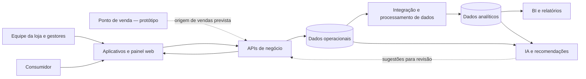

# Mottainai — documentação geral do projeto

**Versão:** 1.0

**Data da análise:** 31 de outubro de 2026

**Escopo:** visão geral do propósito, funcionamento esperado, ecossistema de repositórios e organização de acompanhamento entre turmas.

## 1. Visão geral

O Mottainai é um projeto voltado a reduzir o desperdício evitável de alimentos no varejo alimentar. A proposta é ajudar pequenos e médios estabelecimentos — como mercados, mercearias, hortifrutis e lojas de conveniência — a enxergar melhor o que têm em estoque, o que está perto do vencimento e o que precisa ser reposto.

O sistema reúne informações operacionais e analíticas para apoiar decisões como acompanhar lotes, repor produtos, criar promoções, transferir itens entre lojas, encaminhar doações e registrar perdas. Aplicativos e painéis são pensados para públicos diferentes: equipe da loja, gestores e consumidores.

O nome remete ao conceito japonês *mottainai*, uma expressão de pesar pelo desperdício de algo que ainda tem valor. No projeto, essa ideia orienta o uso mais consciente dos alimentos e dos recursos empregados para produzi-los e comercializá-los.

O projeto também se relaciona à agenda de consumo e produção responsáveis, especialmente ao ODS 12. Essa relação expressa a finalidade do produto; não representa certificação nem comprovação de impacto mensurado.

## 2. Problema e finalidade

O varejo alimentar precisa equilibrar disponibilidade, demanda, validade e espaço de armazenamento. Quando esses sinais ficam dispersos ou chegam tarde, podem ocorrer perdas por vencimento, compras inadequadas, falta de produtos e dificuldade para agir sobre itens com baixo giro.

O Mottainai busca transformar os registros de vendas, estoque, produtos e lotes em informação útil para a operação. Sua finalidade é:

- melhorar a visibilidade sobre estoque e validade;
- apoiar o planejamento de compras e a reposição de prateleiras;
- sinalizar riscos e oportunidades para que a equipe decida como agir;
- facilitar iniciativas de promoção, transferência ou doação de alimentos;
- acompanhar resultados operacionais e indicadores de sustentabilidade.

Esses são objetivos do produto, não garantias de redução de perdas. Para demonstrar impacto, será necessário medir os resultados com dados representativos e comparar períodos e operações equivalentes.

## 3. Públicos e benefícios esperados

| Público | Necessidade | Apoio previsto pelo Mottainai |
|---|---|---|
| Proprietário ou gestor | Acompanhar operação, estoque, perdas e desempenho | Painéis, relatórios e informações para priorizar decisões |
| Funcionários e reposição | Registrar e localizar produtos, lotes e ocorrências | Aplicativo operacional, consultas e alertas de trabalho |
| Consumidores | Encontrar ofertas e acompanhar benefícios disponíveis | Aplicativo do cliente, promoções e recursos de fidelidade |
| Equipe de dados e produto | Compreender comportamento, qualidade e evolução da operação | Base analítica, indicadores e experimentação de melhorias |

## 4. Funcionamento em alto nível

O fluxo de negócio pretendido pode ser resumido assim:

1. A loja registra ou atualiza produtos, lotes, estoque, vendas e ocorrências.
2. Os serviços operacionais mantêm os dados necessários à rotina da loja.
3. Processos analíticos organizam dados históricos para relatórios e análises.
4. Regras e recursos de IA podem identificar riscos, estimar demanda ou sugerir ações.
5. A equipe responsável avalia as sugestões e autoriza as ações que exigem decisão humana.
6. Promoções e informações apropriadas podem chegar ao aplicativo do cliente.
7. A operação registra os resultados para permitir acompanhamento posterior.

As recomendações de IA devem ser tratadas como apoio à decisão. A documentação pública descreve fluxos com revisão ou confirmação humana para ações operacionais; não se deve presumir que previsões ou sugestões sejam executadas automaticamente.

## 5. Visão do ecossistema

O diagrama abaixo representa a organização conceitual documentada. Ele não afirma que todas as integrações estejam implantadas ou homologadas.

Na arquitetura descrita pelo Hub, a operação transacional é separada da análise histórica. A integração entre essas camadas é atribuída a processos de dados; a IA pode consumir dados operacionais e analíticos e encaminhar sugestões por serviços de negócio. A documentação do Hub e os repositórios de componentes devem ser consultados juntos, pois documentação arquitetural não comprova por si só a integração em produção.

## 6. Repositórios públicos analisados

Foram considerados os 13 repositórios públicos visíveis na organização em 31/10/2026. Pode haver repositórios privados que não aparecem nessa listagem. A coluna de situação resume o que foi possível observar principalmente na branch `main` e nos documentos públicos; não é uma certificação de implantação.

| Repositório | Papel no ecossistema | Situação observada |
|---|---|---|
| [Mottainai-Primeiro-Ano](https://github.com/Mottainai-One/Mottainai-Primeiro-Ano) | Referência inicial do produto, com frentes de backend, frontend e dados | Material de referência do primeiro ano; não deve ser tomado isoladamente como arquitetura atual integrada |
| [Mottainai-Hub](https://github.com/Mottainai-One/Mottainai-Hub) | Centraliza documentação, visão de arquitetura e orientações por componente | Repositório documental; orienta verificar o estado real em cada repositório e branch |
| [Mottanai-RPA](https://github.com/Mottainai-One/Mottanai-RPA) | Automatiza fluxos de integração e carga de dados | README descreve sincronizações e cargas; execução efetiva depende de configuração, credenciais, permissões e disponibilidade dos bancos |
| [Mottainai-BI](https://github.com/Mottainai-One/Mottainai-BI) | Prepara dados analíticos e publica painéis | Pipeline analítico documentado; dados e validação visual disponíveis ainda limitam conclusões sobre tendências e uso em produção |
| [Mottainai-Mobile-Operacional](https://github.com/Mottainai-One/Mottainai-Mobile-Operacional) | Aplicativo Android para equipe e gestores da loja | Há telas e fluxos descritos, mas o README de `main` aponta usos de dados locais/mock e integração incompleta em partes do app |
| [Mottainai-POS](https://github.com/Mottainai-One/Mottainai-POS) | Protótipo de ponto de venda e possível origem de eventos de venda | Protótipo descrito com dados simulados; conexão operacional e fluxo de checkout não foram comprovados na branch principal |
| [Mottainai-Mobile-Cliente](https://github.com/Mottainai-One/Mottainai-Mobile-Cliente) | Aplicativo Android voltado ao consumidor | Apresenta áreas de lojas, ofertas e fidelidade; estado de integração e homologação precisa ser confirmado nos ambientes do projeto |
| [Mottainai-Frontend](https://github.com/Mottainai-One/Mottainai-Frontend) | Painel web administrativo para gestão | README descreve um protótipo navegável com dados simulados; chamadas HTTP e integração de backend não foram observadas no código principal |
| [Mottainai-Api-SQL-Operacional](https://github.com/Mottainai-One/Mottainai-Api-SQL-Operacional) | Serviços REST para operações e dados da loja | API Spring Boot documentada para o domínio operacional; deployment e compatibilidade com os bancos externos não foram verificados |
| [Mottainai-Api-SQL-Cliente](https://github.com/Mottainai-One/Mottainai-Api-SQL-Cliente) | Base prevista para serviços destinados ao aplicativo do cliente | A branch principal consultada contém um esqueleto inicial; contratos e capacidades descritos em outras branches não foram considerados implementados |
| [Mottainai-PR-Bot](https://github.com/Mottainai-One/Mottainai-PR-Bot) | Automação de revisão e fluxo de pull requests no GitHub | Ferramenta de apoio ao desenvolvimento; não é funcionalidade do produto usada por lojistas ou consumidores |
| [.github](https://github.com/Mottainai-One/.github) | Configurações, modelos e orientações compartilhadas da organização | Apoio ao trabalho nos repositórios; não é componente de execução do produto |
| [Mottainai-IA](https://github.com/Mottainai-One/Mottainai-IA) | Serviço de IA para conversação, análise e recomendações | O README descreve agentes, previsões e salvaguardas; a disponibilidade e validação do serviço integrado não foram comprovadas nesta análise |

### 6.1 Componentes mencionados em documentos

Documentos do Hub também fazem referência a repositórios ou componentes de banco operacional, API NoSQL e Redis. Eles não aparecem entre os 13 repositórios públicos listados pela organização consultada nesta análise. Isso não permite concluir que não existam: podem ser privados, estar em outra organização ou ter sido movidos. Suas implementações não puderam ser inspecionadas como código público nesta revisão.

## 7. Estado e limites do que se pode afirmar

Os repositórios mostram frentes em diferentes níveis de maturidade: documentação arquitetural, protótipos, APIs em desenvolvimento, pipelines descritos e recursos de IA. A existência de README, tela ou fluxo documentado não comprova integração funcional, disponibilidade em produção, homologação ou uso por lojas.

Há divergências entre documentos sobre tecnologias e integração dos aplicativos. Por exemplo, o README público do aplicativo operacional menciona serviços Firebase para funções de negócio, enquanto as orientações internas atuais do projeto indicam uso de Firebase apenas para notificações FCM e direcionam dados de negócio para APIs e PostgreSQL. Essa decisão precisa ser reconciliada pela equipe. Esta visão geral apresenta a arquitetura-alvo descrita nas orientações internas e não trata Firebase como arquitetura aprovada para persistência de dados de negócio.

Também não foram encontrados dados suficientes para declarar uma redução percentual de desperdício, uma previsão com determinada precisão ou um impacto ambiental quantitativo. Esses resultados devem ser comunicados apenas depois de validação com dados adequados, metodologia documentada e período de observação definido.

## 8. Equipe e acompanhamento entre turmas

Nesta documentação, “afiliação” ou “parentesco” significa o vínculo de acompanhamento acadêmico e técnico entre uma pessoa do segundo ano e uma pessoa do primeiro ano. Não se refere a parentesco familiar.

### Segundo ano

- Isabella Gimenes Dos Santos
- Rebecca Sarah Duarte Paulucci — PO
- Arthur do Vale Silva — SCRUM
- Kevin Jun Yokoyama
- João Pedro de Sousa Capelli
- Ana Clara Araújo Costa

### Primeiro ano

- Giovanna Gruer Sartori
- João Victor Vieira Rodrigues
- Miguel Quadros Araújo
- Luana Pedroso Silva — PO
- Pedro Henrique Angelo pereira de Souza
- Gustavo Cardoso Ferreia — SCRUM

### Afiliação por área

| Área | Responsável do segundo ano | Pessoa acompanhada do primeiro ano |
|---|---|---|
| Frontend | Isabella Gimenes Dos Santos | Luana Pedroso Silva — PO |
| Frontend | João Pedro de Sousa Capelli | Giovanna Gruer Sartori |
| Backend | Rebecca Sarah Duarte Paulucci — PO | João Victor Vieira Rodrigues |
| Backend | Kevin Jun Yokoyama | Pedro Henrique Angelo pereira de Souza |
| Dados | Ana Clara Araújo Costa | Gustavo Cardoso Ferreia — SCRUM |
| Dados | Arthur do Vale Silva — SCRUM | Miguel Quadros Araújo |

Os nomes e as atribuições acima foram transcritos da relação fornecida para esta documentação. A tabela registra o vínculo informado e não presume uma hierarquia formal ou responsabilidade de gestão.

## 9. Referências

- [Organização Mottainai-One — repositórios públicos](https://github.com/orgs/Mottainai-One/repositories)
- [Mottainai-Hub — documentação central](https://github.com/Mottainai-One/Mottainai-Hub)
- [README da IA](https://github.com/Mottainai-One/Mottainai-IA)
- [README da API SQL Operacional](https://github.com/Mottainai-One/Mottainai-Api-SQL-Operacional)
- [README do aplicativo operacional](https://github.com/Mottainai-One/Mottainai-Mobile-Operacional)
- [README do aplicativo do cliente](https://github.com/Mottainai-One/Mottainai-Mobile-Cliente)
- [README do frontend web](https://github.com/Mottainai-One/Mottainai-Frontend)
- [README do BI](https://github.com/Mottainai-One/Mottainai-BI)
- [README do RPA](https://github.com/Mottainai-One/Mottanai-RPA)
- Materiais enviados como contexto: `Documentação Mottainai.txt` e `Mottainai - Versão final.txt`.
- Contexto interno do workspace: `CONTEXT.md` e `contexto/decisoes-e-estado-atual.md`.

## 10. Nota de manutenção

Esta documentação é uma visão geral do projeto, não substitui a documentação específica de APIs, bancos, aplicativos ou pipelines. Atualize-a quando a finalidade do produto, a arquitetura aprovada, o estado de integração ou a composição da equipe mudar. Ao descrever funcionalidades, indique se são objetivo, protótipo, implementação em desenvolvimento, integração homologada ou operação comprovada.
