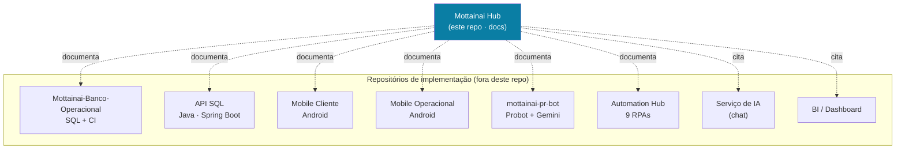
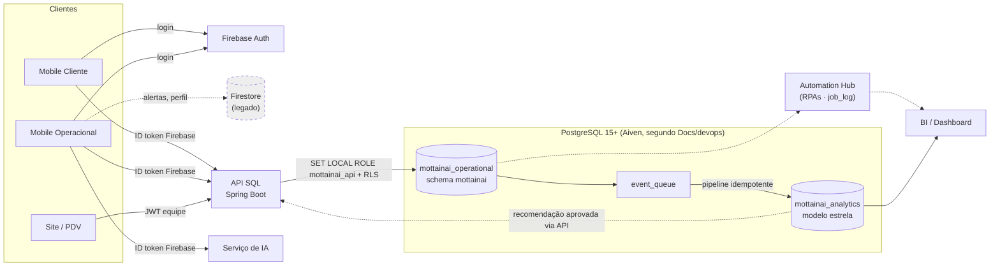
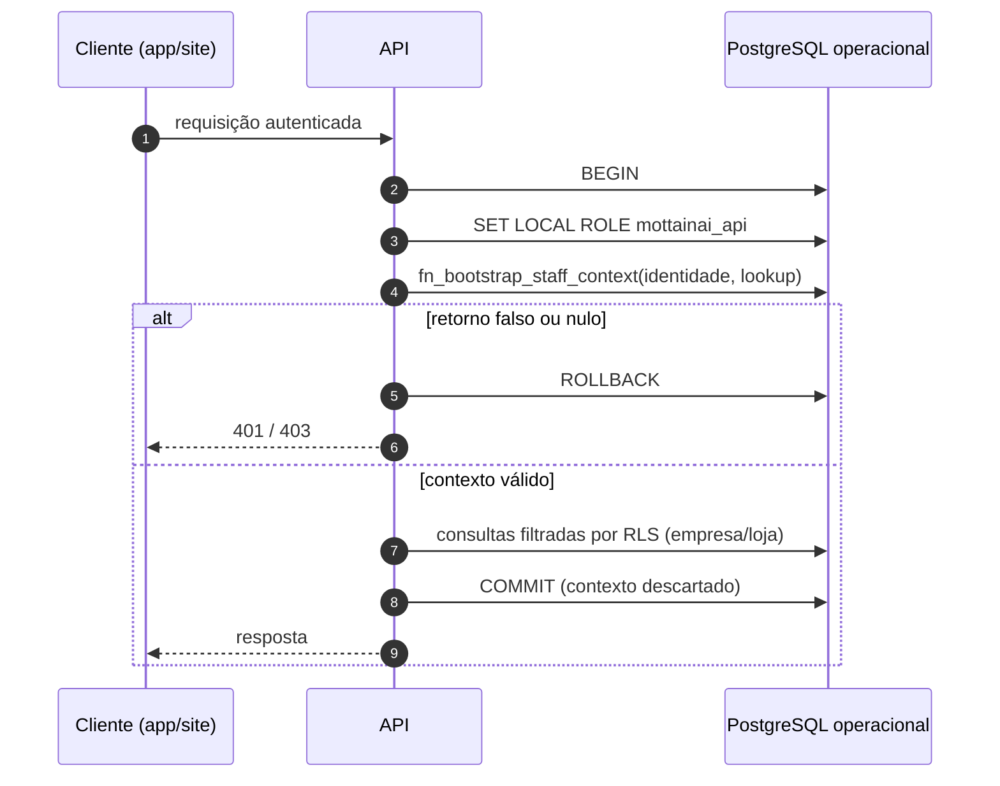
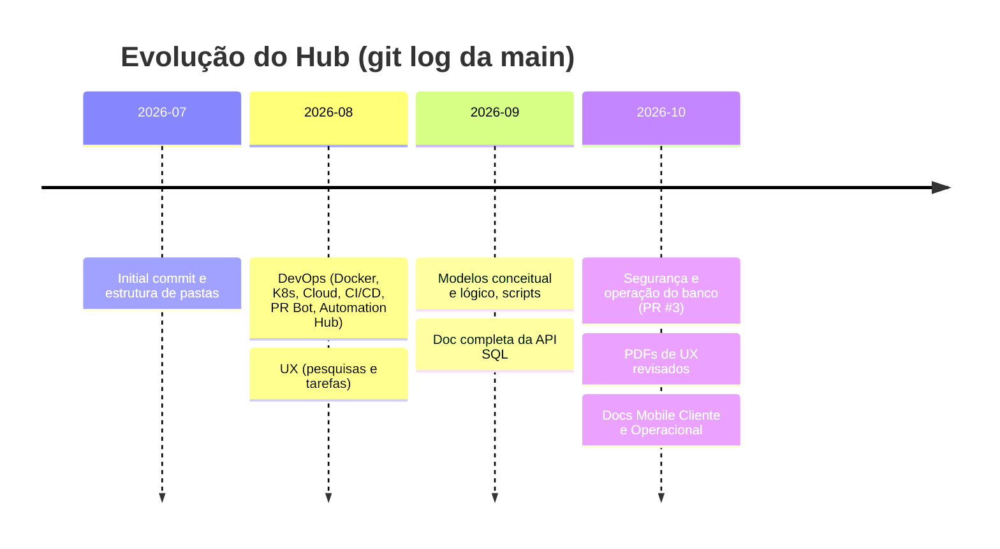

<div align="center">

# Mottainai Hub

**Central de documentação e arquitetura do ecossistema Mottainai: gestão preditiva de estoque para pequenos e médios varejos**

*Um repositório só de documentação: modelos de banco, contrato de segurança, API, DevOps, apps mobile e pesquisa de UX, versionados em Markdown e PDF. Não há código executável aqui.*

<br/>

[](#visão-geral)
[](#estrutura-do-repositório)
[-12%20arquivos-EC1C24?style=for-the-badge&logo=adobeacrobatreader&logoColor=white)](Docs/ux/00-indice-e-status-da-rubrica.pdf)

[-4169E1?style=flat-square&logo=postgresql&logoColor=white)](Docs/banco/README.md)
[-6DB33F?style=flat-square&logo=springboot&logoColor=white)](Docs/api/sql/sql-api-full-documentation.md)
[-3DDC84?style=flat-square&logo=android&logoColor=white)](Docs/mobile/MOBILE-CLIENTE.md)
[-FFC61C?style=flat-square&logo=k3s&logoColor=black)](Docs/devops/02-kubernetes.md)
[](#qualidade-e-automação)

<br/>

[Visão geral](#visão-geral) •
[Ecossistema](#papel-no-ecossistema) •
[Arquitetura](#arquitetura-documentada) •
[Tecnologias](#tecnologias-documentadas) •
[Estrutura](#estrutura-do-repositório) •
[Mapa](#mapa-da-documentação) •
[Como usar](#como-usar-e-contribuir) •
[Riscos](#divergências-riscos-e-limitações)

</div>

---

## Visão geral

O **Mottainai** (もったいない, expressão japonesa para *"que desperdício"*) é um sistema inteligente de gestão preditiva de estoque para pequenos e médios varejos, desenvolvido como projeto acadêmico multi-repositório na organização [Mottainai-One](https://github.com/Mottainai-One).

Este repositório, o **Mottainai Hub**, é a **central de documentação** do ecossistema. O próprio `README.md` da `main` o define como *"Central de documentação e arquitetura do ecossistema Mottainai"*, e o conteúdo confirma: todos os 52 arquivos versionados são Markdown (`.md`/`.MD`), PDF ou placeholders vazios. Não existe manifest de build, `Dockerfile`, `docker-compose`, script, workflow `.github/` nem `.env.example`.

| | Princípio declarado nos documentos | Onde aparece |
|---|---|---|
| **1** | **Documentação, não código-fonte.** O SQL executável fica no repositório do banco, e o Hub "não deve ser usado como origem de migrations". | [`Docs/banco/README.md`](Docs/banco/README.md) |
| **2** | **Dois PostgreSQL fisicamente separados.** O operacional guarda o estado atual, e o analítico guarda histórico, BI e previsões. | [`Docs/banco/README.md`](Docs/banco/README.md) |
| **3** | **Multitenancy por empresa e loja via RLS.** O contexto do tenant vem do banco, nunca do cliente. | [`Docs/banco/seguranca/01-arquitetura-de-seguranca.md`](Docs/banco/seguranca/01-arquitetura-de-seguranca.md) |
| **4** | **Código prevalece sobre o documento.** A doc da API afirma que, em caso de divergência, valem os controllers e o Swagger. | [`Docs/api/sql/sql-api-full-documentation.md`](Docs/api/sql/sql-api-full-documentation.md) |
| **5** | **Estado honesto das entregas.** Os documentos mobile separam o que está planejado, implementado, publicado e homologado. | [`Docs/mobile/`](Docs/mobile/) |

> [!NOTE]
> Quase tudo o que este README diz sobre APIs, bancos, apps e infraestrutura vem **do que os documentos do Hub afirmam**. Esses componentes moram em outros repositórios e **não foram verificados contra o código deles** nesta análise.

---

## Papel no ecossistema

O Hub concentra a documentação transversal e aponta para os repositórios que implementam cada parte. A tabela abaixo lista os repositórios **citados com URL** nos documentos do Hub:

| Repositório citado | Papel, segundo o Hub | Onde é citado |
|---|---|---|
| [`Mottainai-Banco-Operacional`](https://github.com/Mottainai-One/Mottainai-Banco-Operacional) | Scripts SQL (PostgreSQL), instaladores e CI do banco (`ci.yml`) | `Docs/banco/README.md`, `Docs/devops/` |
| [`mottainai-pr-bot`](https://github.com/Mottainai-One/mottainai-pr-bot) | GitHub App (Probot + Gemini) para criar, revisar e mesclar PRs, com Docker, K8s e CD | `Docs/devops/` |
| [`.github`](https://github.com/Mottainai-One/.github) | Template de PR da organização | `Docs/devops/05-code-review-pr.md` |
| `Mottainai-Hub` / `Mottainai-Hub-` | Este repositório (o sufixo `-` aparece em documentos antigos) | `Docs/banco/README.md`, `Docs/devops/README.md` |

Outros componentes aparecem **sem URL de repositório**:

| Componente | Como aparece no Hub | Repositório |
|---|---|---|
| API SQL (Java/Spring Boot) | Pacote `com.institutojf.mottainai`, 18 controllers e 83 operações HTTP | não confirmado no repositório |
| Mobile Cliente (Android) | Checkout `Mottainai-Mobile-Cliente-work`, branch `fix/client-ci` | não confirmado no repositório |
| Mobile Operacional (Android) | Checkout `Mottainai-Mobile-Operacional-integration` | não confirmado no repositório |
| Serviço de IA / chat | Recebe token Firebase do app operacional e resolve funcionário, empresa e loja | não confirmado no repositório |
| Automation Hub (RPAs) | 9 robôs que escrevem em `job_log`; guia em `mottainai-automation-hub/GUIA_RPAs.md` | não confirmado no repositório |
| BI / Dashboard | Consome o banco analítico e o Data Mart | não confirmado no repositório |



---

## Arquitetura documentada

### Fluxo de dados entre os componentes

O diagrama consolida o que `Docs/banco`, `Docs/api`, `Docs/mobile` e `Docs/devops` descrevem. As arestas tracejadas indicam integrações descritas como parciais, legadas ou pendentes.



### Separação operacional x analítico

| Banco | Schema principal | Responsabilidade | Escrita pela API? |
|---|---|---|---|
| `mottainai_operational` | `mottainai` | Cadastros, usuários, produtos, estoque, compras, vendas, PDV e auditoria | Sim, via role `mottainai_api` |
| `mottainai_analytics` | `mottainai_analytics` | Modelo estrela, histórico, indicadores, BI, previsões e recomendações | Não. Só o pipeline de ingestão escreve |

Segundo [`Docs/banco/README.md`](Docs/banco/README.md), os bancos não compartilham FK, `dblink` nem transação distribuída. O operacional publica eventos confirmados em `event_queue`, e um pipeline idempotente carrega dimensões e fatos no analítico, com `etl_dead_letter` para falhas.

### Domínios do modelo conceitual

| # | Domínio | Conceitos centrais | Documento lógico |
|---|---|---|---|
| D1 | Multitenancy / Cadastro | Plano, Empresa, Loja, Funcionário, Usuário, Papel | [`02-cadastro-e-empresa.md`](Docs/banco/model-logico/02-cadastro-e-empresa.md) |
| D2 | Catálogo & Compras | Produto, Categoria, Perfil Fiscal, Fornecedor, Pedido, Recebimento/NF | [`03-produto-e-compras.md`](Docs/banco/model-logico/03-produto-e-compras.md) |
| D3 | Estoque | Lote, Estoque, Movimentação, Reposição (FEFO) | [`04-estoque.md`](Docs/banco/model-logico/04-estoque.md) |
| D4 | Vendas & PDV | Cliente, Terminal, Turno, Venda, Item, Pagamento, Documento Fiscal | [`05-vendas-pdv.md`](Docs/banco/model-logico/05-vendas-pdv.md) |
| D5 | Fidelidade & Cliente | Conta de pontos, Transação, Recompensa, Resgate, Geocerca | [`06-fidelidade-promocoes.md`](Docs/banco/model-logico/06-fidelidade-promocoes.md) |
| D6 | Promoções | Promoção, Item promocional, Aprovação | [`06-fidelidade-promocoes.md`](Docs/banco/model-logico/06-fidelidade-promocoes.md) |
| D7 | Inteligência (Motor) | Alerta, Ação sugerida, Ação executada, Diagnósticos, Regras | [`07-inteligencia-motor.md`](Docs/banco/model-logico/07-inteligencia-motor.md) |
| D8 | Logística & Sustentabilidade | Transferência, Doação, Avarias/Descarte | [`08-logistica-sustentabilidade.md`](Docs/banco/model-logico/08-logistica-sustentabilidade.md) |
| D9 | Observabilidade & Governança | Auditoria, Logs, Eventos, Jobs, KPI, Históricos | [`09-auditoria-observabilidade.md`](Docs/banco/model-logico/09-auditoria-observabilidade.md) |
| D10 | Análise & BI | Indicadores, dashboards, previsões, impacto | [`10-camada-analitica.md`](Docs/banco/model-logico/10-camada-analitica.md) |

### Contrato de segurança de uma requisição (banco operacional)



<details>
<summary><b>Controles de banco descritos em <code>Docs/banco/</code></b></summary>

<br/>

- `mottainai_api` é role de grupo `NOLOGIN`, sem DDL e sem `BYPASSRLS`. O login real da API é membro dela e usa `SET LOCAL ROLE`.
- O contexto (`user_id`, `company_id`, `store_id`) é derivado de `app_user`, `employee`, `retail_store` e `company`, e vale só durante a transação.
- `SET` e `set_config` são revogados para os parâmetros `app.current_*`, o que impede falsificar o tenant.
- Sessões de funcionário (`staff_session`) guardam só o **hash** do refresh token e podem ser revogadas. Reutilização de token revoga a sessão.
- Senhas são calculadas pela aplicação com **Argon2id**, e o banco recebe só o hash.
- A auditoria é imutável para a API e remove CPF e hashes do JSON.
- `purchase_order`, `inventory_movement`, `sales_transaction` e `audit_log` têm partições mensais (12 meses anteriores, o atual e 6 futuros).
- Há diretrizes de backup, restauração mensal, monitoramento e LGPD em [`03-backup-monitoramento-e-lgpd.md`](Docs/banco/operacao/03-backup-monitoramento-e-lgpd.md).

</details>

---

## Tecnologias documentadas

> [!IMPORTANT]
> Este repositório **não usa** nenhuma das tecnologias abaixo em tempo de execução: o "stack" dele é Markdown e PDF. A tabela registra o que os documentos do Hub **afirmam** sobre os outros repositórios. As versões vêm do texto dos documentos, não de manifests.

<table>
<tr>
<td align="center" width="140"><br/><b>Markdown + PDF</b><br/><sub>Formato deste<br/>repositório</sub></td>
<td align="center" width="140"><br/><b>PostgreSQL 15+</b><br/><sub>Operacional<br/>e analítico</sub></td>
<td align="center" width="140"><br/><b>Java 21</b><br/><sub>API SQL<br/>(Maven)</sub></td>
<td align="center" width="140"><br/><b>Spring Boot 4.0.0</b><br/><sub>Security 7.1.0,<br/>Data JPA, Flyway 10.x</sub></td>
</tr>
<tr>
<td align="center" width="140"><br/><b>Android</b><br/><sub>Java + XML,<br/>minSdk 26 / SDK 36</sub></td>
<td align="center" width="140"><br/><b>Firebase Auth</b><br/><sub>Login dos apps;<br/>Firestore legado</sub></td>
<td align="center" width="140"><br/><b>Docker</b><br/><sub>Multi-stage<br/><code>node:20-alpine</code> (PR Bot)</sub></td>
<td align="center" width="140"><br/><b>K3s via k3d</b><br/><sub>Deployment, Service,<br/>HPA (PR Bot)</sub></td>
</tr>
<tr>
<td align="center" width="140"><br/><b>GitHub Actions</b><br/><sub>CI do banco,<br/>CD do PR Bot</sub></td>
<td align="center" width="140"><br/><b>Probot</b><br/><sub>GitHub App<br/>de PRs</sub></td>
<td align="center" width="140"><br/><b>Gemini</b><br/><sub>Review de PR<br/>por IA</sub></td>
<td align="center" width="140"><br/><b>Render · Aiven · AWS</b><br/><sub>Hospedagem free tier<br/>e PG gerenciado</sub></td>
</tr>
</table>

<details>
<summary><b>Versões e componentes citados, com a fonte de cada um</b></summary>

<br/>

| Componente | Versão citada | Documento |
|---|---|---|
| PostgreSQL | 15+ (CI do banco valida em PG 15) | `Docs/banco/README.md`, `Docs/devops/04-ci-cd.md` |
| Java | 21 | `Docs/api/sql/sql-api-full-documentation.md` |
| Spring Boot / Spring Security | 4.0.0 / 7.1.0 | idem |
| Spring Data JPA / Hibernate | 4.0.0 / 6.4+ | idem |
| Spring Cloud (OpenFeign) | 2025.1.2 | idem |
| Flyway | 10.x (migrations `V1` a `V9`) | idem |
| SpringDoc OpenAPI | 3.0.3 | idem |
| Lombok / Jakarta Validation | 1.18.x / 3.0 | idem |
| Caffeine | sem versão (TTL de 10 min, cache de CEP via BrasilAPI) | idem |
| Android (Cliente e Operacional) | minSdk 26, compile/target SDK 36, fontes Java 11 | `Docs/mobile/*.md` |
| Rede Android | Retrofit, OkHttp, Gson (sem versão) | `Docs/mobile/MOBILE-CLIENTE.md` |
| Node.js (imagem do PR Bot) | `node:20-alpine` | `Docs/devops/01-docker.md` |
| K3s | `rancher/k3s:v1.30.11-k3s1` (k3d) | `Docs/devops/02-kubernetes.md` |
| Actions | `actions/checkout@v4`, `docker/build-push-action@v5` | `Docs/devops/04-ci-cd.md` |
| Lint e segurança (CI do banco) | Gitleaks, sqlfluff, markdownlint (sem versão) | `Docs/devops/04-ci-cd.md` |

</details>

---

## Estrutura do repositório

Estado da branch `main` no commit `c45eb97`:

```text
Mottainai-Hub/
├── README.md                         # Índice curto com links para cada área
├── CHANGELOG.MD                      # Entradas de 2026-10-02 e 2026-10-19
└── Docs/
    ├── api/
    │   ├── sql/
    │   │   └── sql-api-full-documentation.md   # API SQL (Spring Boot): stack, auth, 83 operações
    │   └── txt                       # placeholder vazio
    ├── banco/                        # 23 arquivos, ~2,4 mil linhas
    │   ├── README.md                 # Visão dos dois PostgreSQL e regra de integração
    │   ├── modelo-conceitual/        # Domínios D1–D10, entidades e relacionamentos
    │   ├── model-logico/             # 11 documentos: schemas, tabelas, enums, camada analítica
    │   ├── operacao/                 # Instalação, migrations, sessões/RLS, backup, LGPD
    │   ├── script/                   # Organização dos scripts SQL (que vivem em outro repo)
    │   └── seguranca/                # Arquitetura de segurança do operacional
    ├── devops/                       # 7 arquivos: Docker, K8s, Cloud, CI/CD, PR Bot, Automation Hub
    ├── mobile/
    │   ├── MOBILE-CLIENTE.md                              # App Cliente (25 seções)
    │   └── MOTTAINAI-OPERACIONAL-FUNCIONAL-E-TECNICO.md   # App Operacional (26 seções)
    ├── ux/                           # 12 PDFs de UX (3 a 5 páginas cada)
    ├── documentacao-tecnica/txt      # placeholder vazio
    ├── eqs/txt                       # placeholder vazio
    ├── ia/txt                        # placeholder vazio
    └── interdisciplinar/txt          # placeholder vazio
```

> [!NOTE]
> As pastas `Docs/ia/`, `Docs/eqs/`, `Docs/documentacao-tecnica/` e `Docs/interdisciplinar/` contêm apenas um arquivo `txt` **vazio** (0 linhas), que só reserva o diretório no Git. A documentação de IA, por exemplo, **ainda não existe** no Hub.

---

## Mapa da documentação

| Área | Ponto de entrada | Conteúdo | Última data no documento |
|---|---|---|---|
| Bancos de dados | [`Docs/banco/README.md`](Docs/banco/README.md) | Operacional x analítico, regra de integração, características do operacional | 2026-10-02 |
| Modelo conceitual | [`modelo-conceitual/README.md`](Docs/banco/modelo-conceitual/README.md) | Domínios e entidades | não informado |
| Modelo lógico | [`model-logico/README.md`](Docs/banco/model-logico/README.md) | Tabelas, campos, FKs, índices, enums e camada analítica | 2026-09-04 |
| Segurança do banco | [`seguranca/01-arquitetura-de-seguranca.md`](Docs/banco/seguranca/01-arquitetura-de-seguranca.md) | Roles, contexto por transação, RLS, auditoria e checklist | não informado |
| Operação do banco | [`operacao/README.md`](Docs/banco/operacao/README.md) | Instalação via `psql`, ordem de migrations, partições, sessões, backup e LGPD | não informado |
| Scripts SQL | [`script/README.md`](Docs/banco/script/README.md) | Organização dos scripts em `Mottainai-Banco-Operacional` | não informado |
| API SQL | [`sql-api-full-documentation.md`](Docs/api/sql/sql-api-full-documentation.md) | Stack, dois filter chains (Firebase RS256 para clientes, JWT HS256 para equipe), 18 controllers, 83 operações, Flyway | 2026-08-30 |
| DevOps | [`Docs/devops/README.md`](Docs/devops/README.md) | Docker, K3s, Cloud, CI/CD, PR Bot e Automation Hub, mapeados aos requisitos M1–M3 e E2–E3 | 13/08/2026 |
| Mobile Cliente | [`MOBILE-CLIENTE.md`](Docs/mobile/MOBILE-CLIENTE.md) | Firebase só para autenticação, catálogo, lojas/mapa, fidelidade, contratos HTTP | CHANGELOG: 2026-10-19 |
| Mobile Operacional | [`MOTTAINAI-OPERACIONAL-FUNCIONAL-E-TECNICO.md`](Docs/mobile/MOTTAINAI-OPERACIONAL-FUNCIONAL-E-TECNICO.md) | Perfis, scanner, inventário, avarias, alertas/sugestões/chat IA, offline, pendências | situação local em 19/10 |
| UX | [`00-indice-e-status-da-rubrica.pdf`](Docs/ux/00-indice-e-status-da-rubrica.pdf) | Ideação, pesquisas, protótipo, heurística, testes com usuários, A/B, proposta de valor, JTBD e design system | PDFs gerados em 2026-10-17 |

<details>
<summary><b>Os 12 PDFs de UX (título e páginas, conforme os metadados)</b></summary>

<br/>

| Arquivo | Título | Páginas |
|---|---|:---:|
| `00-indice-e-status-da-rubrica.pdf` | Índice e status da documentação | 3 |
| `01-elaboracao-da-apresentacao-processo-de-ideacao.pdf` | Processo de ideação | 3 |
| `01.1-dados-das-pesquisas-qualitativas-e-quantitativas.pdf` | Pesquisas, benchmark e ideação | 5 |
| `02-prototipo-mobile-em-alta-fidelidade.pdf` | Protótipo mobile em alta fidelidade | 3 |
| `03-analise-heuristica.pdf` | Análise heurística | 5 |
| `04-compilado-de-testes-com-usuarios-tempo-e-dificuldade.pdf` | Testes com usuários | 3 |
| `05-teste-a-b-e-matriz-de-priorizacao-pos-testes.pdf` | Teste A/B e priorização | 4 |
| `06-mapa-de-features-core-adjacente-transformacional.pdf` | Mapa de features | 3 |
| `07-matriz-de-proposta-de-valor.pdf` | Matriz de proposta de valor | 4 |
| `EXTRA-01-v2-do-prototipo-e-nova-documentacao-de-testes.pdf` | Evolução V2 e reteste | 3 |
| `EXTRA-02-jobs-to-be-done-jornada-ideal-e-relatorio-de-melhorias.pdf` | Jobs, jornadas e melhorias | 4 |
| `EXTRA-03-ui-kit-documentacao-do-design-system.pdf` | Sistema visual da documentação | 4 |

<sub>O conteúdo textual dos PDFs não foi extraído nesta análise. Só os metadados (título e número de páginas) foram lidos.</sub>

</details>

<details>
<summary><b>Componentes de DevOps descritos (pertencem a outros repositórios)</b></summary>

<br/>

| Tema | Resumo do documento | Repositório de origem |
|---|---|---|
| Docker | Dockerfile multi-stage `node:20-alpine`, usuário não-root e porta 3000. O `docker-compose` serve só para dev | `mottainai-pr-bot` |
| Kubernetes | K3s via k3d, Deployment com probes em `/ping`, HPA de 2 a 6 réplicas (CPU 70%) e overlays `dev` (1 réplica) e `prod` (3 réplicas) | `mottainai-pr-bot` |
| Cloud | PostgreSQL gerenciado na Aiven, PR Bot no Render (plano free) e AWS Free Tier como alternativa | vários |
| CI | `ci.yml` com 8 jobs: schema em PG 15, dataLoad, SQL lint, Gitleaks, markdownlint, checagem de `.env` e sqlfluff (um bloqueante, outro não) | `Mottainai-Banco-Operacional` |
| CD | `cd.yml` com `build-push` para o GHCR, `deploy-dev` automático no merge na `main` e `deploy-prod` manual com aprovação | `mottainai-pr-bot` |
| PR Bot | Cria PR por push, faz review com Gemini, aplica descrição pela label `ai:apply-description`, exige 2 approvals e faz auto-merge squash. Branches protegidas: `main`, `develop`, `front-end`, `dados`, `back-end` | `mottainai-pr-bot` |
| Automation Hub | 9 RPAs (Data Pipeline, Data Guardian, Data Mart Updater, Performance Monitor, Backup Guardian, Ops Monitor, Job Monitor, Metrics Consolidator, AI Data Preparation) com observabilidade via `job_log` | não confirmado no repositório |

</details>

---

## Como usar e contribuir

### Ler a documentação

Não há build, servidor nem dependência. Navegue pelos Markdown direto no GitHub ou em qualquer editor, e abra os PDFs de `Docs/ux/` em um leitor de PDF. Para ter uma cópia local:

```bash
git clone https://github.com/Mottainai-One/Mottainai-Hub.git
```

### Roteiro sugerido por perfil

| Perfil | Comece por |
|---|---|
| Backend / API | `Docs/banco/seguranca/` → `Docs/banco/operacao/02-api-sessoes-e-rls.md` → `Docs/api/sql/` |
| Dados / BI | `Docs/banco/README.md` → `Docs/banco/model-logico/10-camada-analitica.md` → `Docs/devops/06-automation-hub.md` |
| Mobile | `Docs/mobile/` → seções de contratos de API e pendências |
| DevOps | `Docs/devops/README.md` → `04-ci-cd.md` → `02-kubernetes.md` |
| Produto / UX | `Docs/ux/00-indice-e-status-da-rubrica.pdf` |

### Convenções observadas no histórico

- Commits em inglês no padrão Conventional Commits, quase sempre com o tipo `docs:` (ex.: `docs(mobile): ...`, `docs(ux): ...`).
- Parte dos commits é criada pelo `mottainai-pr-bot[bot]`, coerente com o fluxo de PR automatizado descrito em `Docs/devops/05-code-review-pr.md`.
- `CHANGELOG.MD` registra as mudanças por data.
- O SQL executável **não** deve ser versionado aqui. Migrations ficam no repositório do banco.

> [!TIP]
> Ao mudar um contrato (endpoint, tabela, permissão), atualize o documento da área **e** registre a mudança no `CHANGELOG.MD`. Os documentos mobile pedem para indicar explicitamente se a mudança está planejada, implementada, publicada ou homologada.

---

## Configuração e variáveis

O Hub **não tem** `.env`, `.env.example` nem nenhuma configuração própria. Os documentos citam as variáveis abaixo, que pertencem a outros repositórios (aqui vão só os nomes):

| Componente | Variáveis citadas | Documento |
|---|---|---|
| API SQL | `DB_URL`, `DB_USER`, `DB_PASSWORD`, `JWT_SECRET`, `FIREBASE_PROJECT_ID`, `CORS_ALLOWED_ORIGINS`, `JWT_EXPIRATION_MINUTES`, `MAIL_HOST`, `MAIL_PORT`, `MAIL_USERNAME`, `MAIL_PASSWORD`, `PREDICTABLE_PASSWORD_TERMS` | `Docs/api/sql/sql-api-full-documentation.md` |
| Mobile Cliente | `MOTTAINAI_API_BASE_URL`, `MOTTAINAI_MAPS_API_KEY` | `Docs/mobile/MOBILE-CLIENTE.md` |

> [!CAUTION]
> A seção *Verificação Local* da doc da API traz um bloco de exemplo com valores fracos e ilustrativos para o banco local (inclusive uma senha trivial). Trate isso como **exemplo**, nunca como valor real. Credenciais devem ficar no gerenciador de segredos do provedor (Render, Aiven, GitHub Secrets), como o próprio `Docs/devops/` recomenda.

---

## Qualidade e automação

| Item | Situação na `main` |
|---|---|
| Workflows `.github/workflows/` | Inexistentes neste repositório |
| Lint de Markdown / checagem de links | Não configurado aqui. O markdownlint só é citado na CI do repositório do banco |
| Templates de issue/PR | Não versionados aqui. O template de PR vem do repo `.github` da organização, segundo a documentação |
| Proteção de branch / review | Descritos em `Docs/devops/05-code-review-pr.md` (2 approvals, auto-merge). A configuração real não pôde ser verificada pelo clone |

---

## Status e histórico



| Área | Status no Hub |
|---|---|
| Banco (conceitual, lógico, segurança, operação) |  |
| API SQL | -yellowgreen?style=flat-square) |
| DevOps |  |
| Mobile Cliente e Operacional |  |
| UX |  |
| IA, EQS, Documentação técnica, Interdisciplinar |  |
| CI do próprio Hub |  |

Esta análise descreve a branch `main`. Outras branches podem conter alterações ainda não integradas.

---

## Divergências, riscos e limitações

### Divergências entre documentos

> [!WARNING]
> Os pontos abaixo foram encontrados **comparando documentos do próprio Hub**. Sem acesso ao código dos outros repositórios, não dá para dizer qual versão está correta. A doc da API (2026-08-30) é anterior ao hardening de segurança do banco (2026-10-02), o que sugere, **por inferência**, que ela está desatualizada nesses pontos.

| # | Tema | `Docs/banco/` diz | Outro documento diz |
|---|---|---|---|
| 1 | Hash de senha | Argon2id, calculado pela API | `Docs/api/`: BCrypt strength 10 |
| 2 | Sessão e revogação | `staff_session` com hash do refresh token e revogação por sessão | `Docs/api/`: JWT HS256 com `tokenVersion`, sem `staff_session` |
| 3 | Isolamento de tenant | `SET LOCAL ROLE mottainai_api` + `fn_bootstrap_staff_context` + RLS | `Docs/api/`: não menciona RLS nem `SET LOCAL ROLE` |
| 4 | Origem do schema | SQL executável e instaladores `psql` em `Mottainai-Banco-Operacional` | `Docs/api/`: Flyway `V1`–`V9` dentro da API |
| 5 | Nome do banco | `mottainai_operational` + `mottainai_analytics` | `Docs/devops/03-cloud.md`: `mottainai` + `mottainai_analytics`; `Docs/api/`: banco `mottainai` |
| 6 | Integração operacional → analítico | `event_queue` + pipeline idempotente + `etl_dead_letter` | `Docs/devops/06-automation-hub.md`: RPAs alimentando um "Data Mart" |
| 7 | Nome deste repo | `Mottainai-Hub` | `Docs/devops/README.md` e `model-logico/README.md`: `Mottainai-Hub-` (link antigo) |
| 8 | "Hub" | Este repo é só documentação | O diagrama de `06-automation-hub.md` chama a camada de RPAs de "MOTTAINAI HUB (RPA)", o que pode confundir com este repositório |

### Riscos

| Risco | Impacto | Recomendação |
|---|---|---|
| Documentação da API defasada em relação ao contrato de segurança do banco (itens 1–4) | Implementações seguindo a doc errada podem enfraquecer o isolamento multi-tenant | Revalidar `Docs/api/` contra o código atual da API e o hardening de 2026-10-02 |
| **Links relativos quebrados** em `Docs/mobile/` (`authentication.md`, `catalog.md`, `delivery-status.md`, `../README.md`, `Mottainai-Mobile-Operacional-integration/docs/*.md`) e em `Docs/devops/06-automation-hub.md` (`mottainai-automation-hub/GUIA_RPAs.md`) | O leitor não chega à fonte citada. Os docs foram copiados de outros repos sem ajustar os caminhos | Trocar por URLs absolutas do GitHub ou remover |
| Seções vazias (`ia`, `eqs`, `documentacao-tecnica`, `interdisciplinar`) | Quem chega pelo Hub não encontra a doc de IA nem a interdisciplinar | Preencher ou remover os placeholders e citar os repositórios responsáveis |
| Sem CI no Hub (link check, markdownlint) | Regressões de links e formatação passam despercebidas | Adicionar um workflow leve de lint e checagem de links |
| PDFs binários como fonte de UX | Diffs ilegíveis e conteúdo não pesquisável no GitHub | Versionar um resumo em Markdown ao lado de cada PDF |
| Valores de exemplo de credenciais na doc da API | Risco de serem reaproveitados em ambientes reais | Substituir por placeholders (`<defina-no-cofre>`) |

### Limitações desta análise

- Só a branch `main` foi analisada. O clone é raso (`--depth 50`), mas cobre todo o histórico (17 commits).
- O conteúdo dos 12 PDFs de UX não foi extraído. Só os metadados foram lidos.
- Nenhum outro repositório da organização foi lido. As afirmações sobre API, mobile, banco, PR Bot, RPA, IA e BI refletem **o que o Hub documenta**, não o código desses repositórios.
- Configurações do GitHub (branch protection, GitHub App, secrets) não são visíveis num clone e não foram verificadas.
- Não houve execução de comandos de build, deploy, `psql` ou Docker. Os exemplos citados nos documentos não foram testados.

---

## Rastreabilidade

| Item | Valor |
|---|---|
| Repositório | [Mottainai-One/Mottainai-Hub](https://github.com/Mottainai-One/Mottainai-Hub) |
| Branch | `main` (branch analisada) |
| Commit analisado | `c45eb97` (docs(mobile): Add client and operational documentation, 2026-10-20) |
| Data da análise | 2026-10-27 |
| Método | Leitura estática do clone local, com `git ls-files`, `git log` e `git branch -r`. Sem build nem execução |

<details>
<summary><b>Arquivos consultados</b></summary>

<br/>

- `README.md`, `CHANGELOG.MD`
- `Docs/banco/README.md`
- `Docs/banco/modelo-conceitual/README.md`, `01-visao-geral-e-dominios.md`
- `Docs/banco/model-logico/README.md`, `01-schemas-e-convencoes.md`, `02-cadastro-e-empresa.md` (trecho), `05-vendas-pdv.md` (trecho), `07-inteligencia-motor.md`, `10-camada-analitica.md`
- `Docs/banco/operacao/01-instalar-e-atualizar.md`, `02-api-sessoes-e-rls.md`, `03-backup-monitoramento-e-lgpd.md`
- `Docs/banco/script/README.md`, `01-estrutura-do-script.md`
- `Docs/banco/seguranca/01-arquitetura-de-seguranca.md`
- `Docs/api/sql/sql-api-full-documentation.md`
- `Docs/devops/README.md`, `01-docker.md`, `02-kubernetes.md`, `03-cloud.md`, `04-ci-cd.md`, `05-code-review-pr.md`, `06-automation-hub.md`
- `Docs/mobile/MOBILE-CLIENTE.md`, `Docs/mobile/MOTTAINAI-OPERACIONAL-FUNCIONAL-E-TECNICO.md`
- `Docs/ux/*.pdf` (somente metadados)
- `Docs/{api,documentacao-tecnica,eqs,ia,interdisciplinar}/txt` (confirmados vazios)

</details>

---

<div align="center">

**Mottainai** · *menos desperdício, mais inteligência no estoque*

<sub>Parte do ecossistema <a href="https://github.com/Mottainai-One">Mottainai-One</a></sub>

</div>
